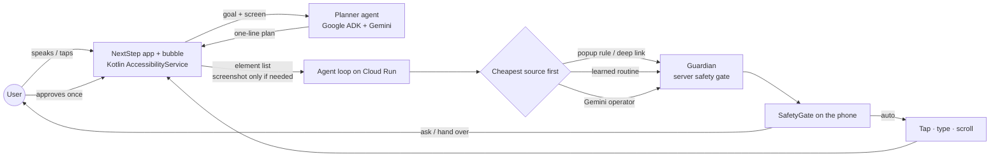

<p align="center"></p>

# NextStep

**An AI agent that uses your phone for you.** Team Northstar · Google Cloud AI Builder Cup 2026 (JAPAC) · Theme: *Sustainability & Social Impact*

| | |
|---|---|
| 📱 **Download the Android app** | [**NextStep.apk** (latest release)](https://github.com/justToLearnNExplore/nextstep/releases/latest/download/NextStep.apk) · [all releases](https://github.com/justToLearnNExplore/nextstep/releases) |
| ▶️ **4-minute demo** | https://youtu.be/HlGCqERawWU |
| ▶️ **All features (full walkthrough)** | https://youtu.be/MHEeDlpe5HM |
| 👨‍👩‍👧 **Family view (live)** | https://nextstep-northstar.web.app · sample timeline: [/demo](https://nextstep-northstar.web.app/demo) |

> Tip: the videos are best watched at **0.75× speed**.

Seniors, house help and millions of first-time smartphone users depend on someone else for simple phone tasks: *"Beta, yeh phone dekhna…"*. With NextStep they just **say what they need**, in English, Hindi or Kannada. NextStep plans the task with **Gemini**, then reads the screen and **taps, types and scrolls inside real apps** like Blinkit, Uber and WhatsApp. It asks before anything important, never touches passwords, OTPs or PINs, and learns routines so repeat tasks get faster.

---

## Download and use

### Install (2 minutes)

1. On an Android phone (**Android 10 or newer**), open the [latest NextStep.apk](https://github.com/justToLearnNExplore/nextstep/releases/latest/download/NextStep.apk).
2. Open the downloaded file. If asked, allow **Install unknown apps** for your browser or file manager. This is a prototype build signed with a development key, so Android may show an "unknown developer" warning.
3. Open **NextStep**. Setup walks you through:
   - choosing a language (English, हिंदी, ಕನ್ನಡ);
   - allowing the **microphone**;
   - **saying your name** (that's your account: no username, password or OTP, ever);
   - turning on **Settings → Accessibility → NextStep helper**, which lets NextStep read the screen and tap for you;
   - optionally, **notification access**, for automatic scam alerts on incoming messages.

The backend is already live on Cloud Run, so there's nothing else to set up.

### Use it

- **Home screen:** tap the big **Tap and speak** button and say what you want ("order one litre milk", "book a ride to the airport"), or use one of the four helpers: **Order groceries**, **Medicine help**, **Book a ride**, **Phone help**.
- **The NextStep bubble** floats at the top-left over every app. Tap it for:
  - **Explain my screen**: what's on screen, in simple words, and a way back;
  - **Check for scam**: checks the message on screen;
  - 🎤 **Speak**: give a command about the current screen (for example "cancel my ride");
  - the **NextStep logo**: opens the app;
  - **✕**: hides the bubble. It comes back when you open NextStep.
  
  Press and hold the bubble to move it.
- **During a task:** NextStep shows one short plan and asks once. After that it works on its own and asks again only before anything important (placing an order, booking a ride, sending a message). You can tap **Add or change something** to change the task, or tap the bubble and choose **Stop**. Every window has a **✕**.
- **Family sharing:** go to **Settings → Share with family**. NextStep sends a one-time link on WhatsApp. Family members open it in a browser and see a live timeline of what NextStep did: tasks, approvals, private steps and scam alerts. They never see passwords, OTPs or messages. **Stop sharing** revokes access at once. A sample timeline is at [/demo](https://nextstep-northstar.web.app/demo).
- **What NextStep did:** Settings → *What NextStep did* shows the senior's own action log.

---

## Features

| Feature | What it does |
|---|---|
| **Speak any task** | One sentence, in the user's language. Gemini plans it, the user approves once, NextStep does it in the real app. |
| **Groceries from a photo** | Snap a handwritten list (Hindi or English). Gemini reads it, skips crossed-out items, and fills the Blinkit cart. Any old items in the cart are removed first, and payment is cash on delivery. |
| **Book a ride** | Say the destination. NextStep opens Uber, picks the cheapest suitable ride, reads out the fare and books **only after your yes**. You can cancel later by voice. |
| **Explain my screen** | A plain-language explanation of any screen, a warning if it's risky (for example a UPI PIN page), and one tap back to safety. |
| **Scam shield** | Rules (lookalike domains, KYC, OTP and urgency patterns) plus an AI classifier. It warns the user, **never opens the link**, and offers only the verified official website. Runs on demand from the bubble, or automatically on new messages. |
| **Medicine help** | A voice-guided camera ("move closer", "hold steady", "more light") for shaky hands, which turns green only when the label is readable (on-device ML Kit). Gemini reads out the name, what it's for and the expiry date. One tap sends the photo to your doctor or family on WhatsApp, after asking first. |
| **Phone help** | Fixes silent mode or low volume (after asking), and reads out missed calls and new messages from the last hour. OTPs are never read out. |
| **Family view** | A live timeline on Firebase Hosting, shared with a one-time WhatsApp link. No login for the senior. |
| **Safe by design** | Asks before anything irreversible; hands every password, OTP, PIN and UPI step to the user; two independent safety gates. |
| **Learns routines** | A successful task becomes a recipe. Repeats replay it, with one quick AI check at the end. |
| **Senior-first UI** | Atkinson Hyperlegible type, AAA contrast, 64dp+ touch targets, icons with words, one-line labels, everything spoken aloud. The mic opens only when you tap it. |

---

## How it works



Every step picks the **cheapest source that works**:
1. **Free rules** dismiss known pop-ups ("Rate us", "Update", ads) without AI.
2. **Deep links** jump straight to search results (Blinkit, YouTube, Uber).
3. **Learned routines** (procedural memory) replay a saved recipe by matching element labels on the live screen, with `{item}` placeholders, and no AI.
4. The **Gemini operator** handles everything else:
   - Fast path: plain Gemini function calling with the phone's own actions (`click`, `type`, `drag_and_drop`, `open_app`…), about 2 s per step.
   - Fallback: **Gemini Computer Use** (mobile environment) handles retries and hard screens.

Each step is a stateless call (goal, step history and current screen), so cost per step stays flat. The phone sends the element list first and attaches a screenshot only when the server asks for it.

### Safety gates

| Gate | When | What NextStep does |
|---|---|---|
| `auto` | Routine steps covered by the approved plan (open app, search, scroll, back) | Does it |
| `confirm` | Place order, book a ride, send a message or photo, install an app, add an address | States exactly what will happen (items, total, fare, recipient) and waits for a tapped **yes** |
| `private` | Password, PIN, OTP, UPI, card or bank fields, payment apps | Hands over: "Please do this yourself, then tap Continue." It never sees or types the value |
| `blocked` | Unverified links in messages, anything before consent | Refuses and explains |

Safety is layered, and each layer can only make a gate stricter:
1. Gemini's own safety policies.
2. The server-side **Guardian** (`backend/app/guardian.py`).
3. The on-device **SafetyGate** (`SafetyGate.kt`), which re-checks every action against the live screen right before it runs.

---

## Built on Google Cloud

| Service | How NextStep uses it |
|---|---|
| **Gemini** (3.8 Flash; 3.5 Flash-Lite for quick checks) | Plans tasks, chooses each tap (function calling, with **Computer Use** as fallback), explains screens, reads medicine labels and grocery lists, checks scams, and summarises missed calls. Structured outputs via **Google ADK** agents. |
| **Cloud Run** (`asia-south1`, Mumbai) | FastAPI + Google ADK agent backend: planner, operator, Guardian, learned routines. Scales to zero when idle. |
| **Firebase** | **Anonymous Auth** gives voice-named accounts with no login; **Hosting** serves the family view, with `/api/**` routed to Cloud Run. |
| **Firestore** | Tasks and action logs, learned routines, profiles and the family timeline. No screenshots, photos or message texts are stored. Locked to the backend (no client access). |
| **Cloud Speech-to-Text** | Voice input in English, Hindi and Kannada. |
| **Secret Manager** | Gemini API key. |
| **Gemma 4** | Scam checks on the free-tier model profile (`MODEL_PROFILE=free`). |

## Performance (measured on the live prototype)

| Metric | Result |
|---|---|
| Agent step (server) | **6.5 s → 2.2 s** median (Computer Use → function-calling fast path, 71 live steps) |
| Planning a task | ~4.5 s median |
| Speech-to-text | ~1.75 s median |
| Gemini calls, grocery order | 10–16 the first time → **1 check** on a learned repeat |
| Input tokens per AI step | ~2.6k (text first, screenshot only when needed) |
| Backend tests | 56 passing |

Measured on Cloud Run (asia-south1) with Gemini 3.8 Flash and a moto g8 power lite (Android 10), October 2026.

---

## Architecture

| Layer | Tech |
|---|---|
| App UI | React Native + Expo, Expo Router, TypeScript |
| Phone control | Kotlin Expo module: AccessibilityService (screen tree, gestures, screenshots; MediaProjection on Android 10), accessibility overlay, Intents, NotificationListenerService, TextToSpeech, AudioRecord with voice-activity detection |
| Camera | CameraX + ML Kit text recognition (on-device readable-label check) |
| Agents | **Google ADK** (Python): planner, operator, screen explainer, scam shield, medicine reader, grocery-list reader, missed-calls summariser |
| Backend | FastAPI on **Cloud Run** |
| Data | **Firestore**, **Firebase Auth** (anonymous), **Secret Manager** |
| Family view | Vite + TypeScript on **Firebase Hosting** |

```
app/                              React Native app (Expo)
  src/app/                        screens: onboarding, talk (home), grocery, grocery-photo, medicine, ride, phone, settings, log
  src/components/                 MicButton, MedicineCamera, NameCapture, FamilySharing, ui
  src/i18n/locales/               en.json, hi.json, kn.json
  modules/nextstep-agent/         Kotlin native module
    android/.../agent/
      NextStepAccessibilityService.kt   hosts everything below
      overlay/BubbleOverlay.kt          bubble, menu, panels (+ StatusRing, LevelBars)
      agent/AgentRunner.kt              on-device agent loop and dialogue
      exec/ActionExecutor.kt            actions → gestures / intents, waits until the screen settles
      safety/SafetyGate.kt              on-device gate (escalate-only)
      screen/ScreenReader.kt            accessibility tree + screenshot (ProjectionService on Android 10)
      voice/VoiceIO.kt                  speech in (Cloud STT) / out (TTS)
      medicine/                         CameraX view + ML Kit label analyser
      notify/NotificationWatcher.kt     scam shield input (opt-in)
      PhoneHelp.kt                      sound fixes, missed calls and messages
backend/                          Python, Cloud Run
  app/main.py                     API endpoints
  app/agent_loop.py               cheapest-first step decision, cart handling, repeat guard
  app/operator.py                 Gemini operator (function calling + Computer Use fallback)
  app/guardian.py                 server-side safety gate
  app/skills.py                   learned routines (record, template, replay)
  app/agents/                     ADK agents: planner, explainer, scam_shield, medicine_reader, assistants
  app/stt.py                      Cloud Speech-to-Text
  app/family.py                   family timeline, invites, viewers
  tests/                          56 tests
dashboard/                        family view (Vite + TS): landing, join link, live timeline, demo
infra/deploy-backend.sh           Cloud Run deploy
infra/deploy-dashboard.sh         Firebase Hosting deploy
```

## Build from source

### Backend

```bash
cd backend
python3 -m venv .venv && .venv/bin/pip install -r requirements-dev.txt
cp .env.example .env   # add GOOGLE_API_KEY
.venv/bin/python -m pytest -q
set -a; source .env; set +a; .venv/bin/uvicorn app.main:app --reload --port 8080
```

Deploy to Cloud Run (see the comments at the top of the script for one-time project setup):

```bash
MODEL_PROFILE=paid REQUIRE_AUTH=true ./infra/deploy-backend.sh
```

### Family view

```bash
cd dashboard && npm install && npm run dev   # http://localhost:5173 (proxies /api to :8080)
./infra/deploy-dashboard.sh                  # Firebase Hosting
```

### Android app

Requires JDK 17 and the Android SDK.

```bash
cd app
npm install
npx expo run:android --device                # development build on a connected phone
cd android && ./gradlew :app:assembleRelease # release APK: app/android/app/build/outputs/apk/release/
```

The backend URL is set in `app.json` (`expo.extra.apiBaseUrl`).

## Adding a language

1. Copy `app/src/i18n/locales/en.json` to `<code>.json` and translate it, including `yesWords`, `noWords` and `noChangeWords`.
2. Add one entry to `LANGUAGES` in `app/src/i18n/index.tsx`.
3. Optionally add the fixed Guardian phrases in `backend/app/i18n.py`. Unknown languages still work, with English fallbacks.

Voice input and output, the overlay and model output all follow the language tag automatically. NextStep keeps to the one selected language end to end.

## Known limitations

- **Android only** (10 or newer). iOS does not allow this kind of control.
- **Apps change.** Third-party apps change their UI. The operator works from the screen itself and retries, but some flows can still break.
- **Secure screens.** Some apps mark screens as secure. Screenshots there are black, so NextStep relies on the accessibility tree.
- **Cash on delivery** depends on the shop. If it isn't available, NextStep hands payment to the user.
